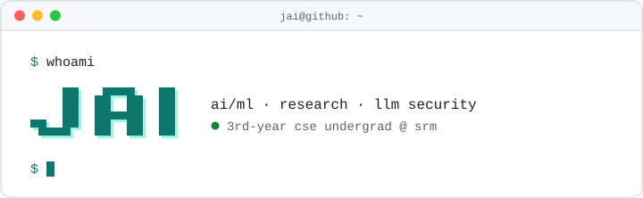

<picture>
  <source media="(prefers-color-scheme: dark)" srcset="./header-dark.svg">
  
</picture>

<h2 align="center">My Work</h2>

<b>LLM security: red-teaming pipelines and guardrail evaluation for language models</b>   
<b>Currently: researching applications of transformers in B5G networks and Sign language</b>  
<b>Open Source: contributor in <a href="https://github.com/Azure/PyRIT"><b>Microsoft PyRIT</b></a> , <a href="https://github.com/cisco-ai-defense/mcp-scanner"><b>Cisco AI Defense: mcp-scanner</b></a> and <a href="https://github.com/microsoft/msticpy"><b>Microsoft msticpy</b></a </b>

## Tech Stack

<i>whatever it takes tbh, but mostly:</i>
  

 

## Connect with Me

*"What a blessing to be tired in the pursuit of a challenge of your own choosing."*

